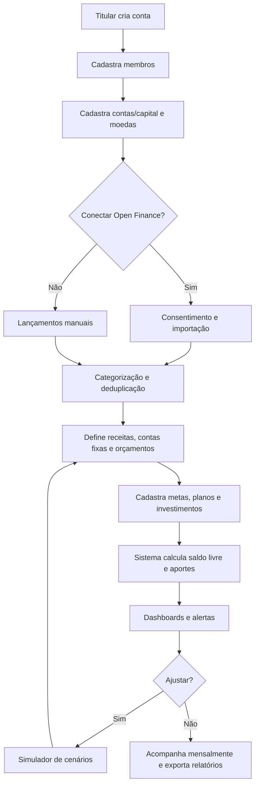
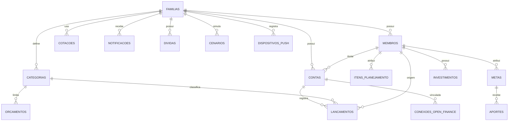

# Documento de Análise – Sistema de Controle Financeiro Familiar

Versão 1.0 | Idioma: pt-BR | Base para PRD e implementação assistida por IA

---

## 1. Visão geral

### 1.1 Problema
A família não tem visão única de quanto possui, quanto pode gastar, onde economizar, como ganhar mais e quando realizará seus planos. Informações ficam dispersas (bancos, planilhas, anotações) e não são segmentadas por pessoa.

### 1.2 Objetivo
Sistema web/PWA de controle financeiro familiar para registrar e acompanhar gastos, ganhos, prioridades, metas e planos, respondendo: **quanto tenho, quanto posso gastar, onde economizar, como ganhar mais, quando realizarei meus planos**.

### 1.3 Escopo

| Dentro | Fora |
|---|---|
| 21 módulos funcionais, 6 dashboards | Login individual por membro |
| Entrada manual + Open Finance | Pagamento/transferência de dinheiro (só leitura bancária) |
| Multi-moeda com BRL como base | Emissão de nota fiscal, declaração de IR |
| PWA (Android e iOS), notificações, offline básico | App nativo na App Store (opcional/futuro) |
| Exportação PDF/Excel | Aconselhamento de investimento regulado |
| Segmentação por membro e "Família" | Multi-família/multi-tenant público (MVP) |

### 1.4 Premissas
| ID | Premissa (escolha padrão) |
|---|---|
| PR-01 | Uma conta (login único) = uma família = um `familia_id`. |
| PR-02 | Backend: **FastAPI** (assíncrono, Pydantic para validação, driver `motor`/`beanie` nativo para MongoDB; OpenAPI automática). Django REST seria menos aderente ao MongoDB. |
| PR-03 | Moeda base: BRL; cotações em fonte pública gratuita (ex.: API do Banco Central/PTAX para fiat; provedor gratuito para cripto/ações). |
| PR-04 | Open Finance via agregador regulado (ex.: Pluggy, Belvo); há custo/limite de plano a validar (Dúvida D-01). |
| PR-05 | Hospedagem com camada gratuita ou baixo custo (ex.: MongoDB Atlas M0, Render/Fly.io/Railway) – custos reais na seção 12. |
| PR-06 | Valores monetários em centavos (inteiro) + código de moeda. |
| PR-07 | Fuso padrão America/Sao_Paulo; datas em UTC no banco. |

### 1.5 Glossário
| Termo | Definição |
|---|---|
| Titular | Dono do login único; administra a família. |
| Membro | Perfil cadastral (marido, esposa, filho) sem login. |
| Família | Pseudo-membro "compartilhado"; registros sem membro específico. |
| Meta | Valor-alvo com prazo e progresso (plano futuro, viagem, reserva). |
| Plano | Objetivo de médio/longo prazo; uma meta com aporte mensal. |
| Saldo livre | Dinheiro disponível após fixas, aportes e metas (RN-001). |
| Lançamento | Transação financeira (entrada ou saída). |

---

## 2. Personas e perfis

| Persona | Descrição | Casos de uso |
|---|---|---|
| Titular (marido, iPhone, programador) | Único dono do login, configura família, bancos, moedas. | UC-01 cadastrar membros; UC-02 conectar Open Finance; UC-03 definir orçamentos; UC-04 exportar relatórios; UC-05 consultar saldo livre. |
| Cônjuge (esposa, Android, nail designer) | Usa o mesmo login em outro aparelho; renda variável. | UC-06 lançar gastos e receitas do dia; UC-07 marcar contas pagas; UC-08 acompanhar planos de negócio extra. |
| Membro filho(a) | Perfil sem login; recebe prioridades, necessidades, plano de faculdade. | UC-09 ter prioridades e itens "preciso" atribuídos; UC-10 ver progresso da meta de faculdade (via titular/cônjuge). |
| Membro "Família" | Pseudo-perfil compartilhado. | UC-11 registrar gastos comuns (mercado, aluguel, viagem). |

---

## 3. Mapa de módulos

### 3.1 Agrupamento e relações
| Grupo | Módulos | Relações principais |
|---|---|---|
| Planejamento pessoal | 1 Prioridades, 2 Quero, 3 Preciso, 4 Consegui | Quero → converte em Meta/Plano (8); Preciso → vira item de compra (7/15); Concluído → Consegui (4). |
| Controle mensal | 5 Economizar, 6 Posso gastar, 7 Todo mês, 15 Mercado, 16 Contas do mês, 19 Orçamento | Contas, Mercado e Posso gastar alimentam Lançamentos e consomem Orçamento (19). |
| Patrimônio | 9 Capital atual, 11 Investir, 17 Dívidas, 18 Reserva | Capital + Investimentos − Dívidas = patrimônio líquido. |
| Receita | 10 Profissão, 20 Outras receitas, 14 Negócio extra | Alimentam fluxo de caixa e saldo livre. |
| Metas | 8 Planos futuros, 12 Lazer, 13 Lugares, 18 Reserva | Aporte mensal necessário reduz saldo livre. |
| Análise | 21 Simulador | Lê todos os módulos, não grava dados reais. |

### 3.2 Jornada principal


---

## 4. Especificação dos módulos

### 4.0 Convenções
**Campos comuns (todos os módulos, não repetidos):** `_id` (ObjectId, auto), `familia_id` (ref, obrigatório), `membro_id` (ref Membro ou `null` = Família; obrigatório pela regra transversal), `criado_em`, `atualizado_em` (data, auto), `deletado_em` (data, soft delete), `observacao` (texto, opcional).

**Regras comuns:**
- RN-TRV-01: todo registro tem `membro_id` ou "Família"; filtro por membro e visão consolidada em toda listagem.
- RN-TRV-02: valores em `valor_centavos` (int) + `moeda` (ISO 4217/cripto); conversão para BRL conforme seção 8.2.
- RN-TRV-03: exclusão lógica; auditoria de criação/edição.
- RN-TRV-04: listagens paginadas, com filtros por membro, período e status.

**Enumerações:** `nivel`: alta|media|baixa; `status_item`: pendente|em_andamento|concluido|cancelado.

---

### Módulo 1 – Prioridades
**Finalidade:** registrar prioridades por membro (ex.: guardar roupas, organizar documentos).

| Campo | Tipo | Obrig. | Regra |
|---|---|---|---|
| titulo | string(120) | Sim | – |
| nivel | enum | Sim | alta/média/baixa |
| status | enum | Sim | padrão pendente |
| prazo | data | Não | se vencido e não concluído, sinalizar atraso |
| recorrencia | enum | Não | nenhuma/semanal/mensal |

- RF-MOD01-01: CRUD de prioridades por membro.
- RF-MOD01-02: ordenar por nível e prazo; destacar atrasadas.
- RF-MOD01-03: concluir uma prioridade permite gerar registro em "Já consegui" (opcional).
- **Telas/ações:** lista com filtros (membro, nível, status), formulário, marcar concluída.

### Módulo 2 – Coisas que quero
**Finalidade:** desejos com valor estimado e prazo (ex.: comprar casa R$ 350.000, 8 anos).

| Campo | Tipo | Obrig. | Regra |
|---|---|---|---|
| titulo | string | Sim | – |
| valor_estimado_centavos, moeda | int, string | Não | > 0 |
| prazo | data | Não | futuro na criação |
| prioridade | enum nivel | Não | – |
| status | enum | Sim | + `convertido` |
| meta_id | ref | Não | preenchido ao converter |

- RF-MOD02-01: CRUD de desejos.
- RF-MOD02-02: converter desejo em plano futuro (módulo 8) copiando título, valor e prazo; status passa a `convertido` (RN-020).
- RF-MOD02-03: totalizar valor dos desejos por membro.
- **Telas/ações:** lista, botão "Converter em plano".

### Módulo 3 – Coisas que preciso
**Finalidade:** necessidades com valor e urgência (ex.: caderno R$ 25, urgência alta).

| Campo | Tipo | Obrig. | Regra |
|---|---|---|---|
| titulo | string | Sim | – |
| valor_estimado_centavos | int | Não | ≥ 0 |
| urgencia | enum nivel | Sim | – |
| status | enum | Sim | pendente/comprado/cancelado |
| item_compra | bool | Não | indica que foi enviado à lista de compras |

- RF-MOD03-01: CRUD.
- RF-MOD03-02: "Marcar como comprado" gera lançamento de despesa (opcional, confirmado pelo usuário).
- RF-MOD03-03: ordenar por urgência.
- **Telas:** lista por urgência, ação "Comprar" → lançamento.

### Módulo 4 – Coisas que já consegui
**Finalidade:** histórico de conquistas (ex.: quitei financiamento do carro).

| Campo | Tipo | Obrig. | Regra |
|---|---|---|---|
| titulo | string | Sim | – |
| data_conquista | data | Sim | não futura |
| valor_centavos, moeda | int, string | Não | – |
| origem | enum | Não | manual/prioridade/desejo/plano/divida |
| origem_id | ref | Não | – |

- RF-MOD04-01: CRUD.
- RF-MOD04-02: criação automática sugerida ao concluir plano, desejo ou quitar dívida.
- RF-MOD04-03: linha do tempo por membro e total conquistado no ano.

### Módulo 5 – Economizar
**Finalidade:** regras/hábitos de economia com meta mensal (ex.: reduzir supérfluos, R$ 300/mês).

| Campo | Tipo | Obrig. | Regra |
|---|---|---|---|
| titulo | string | Sim | – |
| meta_mensal_centavos | int | Sim | > 0 |
| categoria_id | ref | Não | categoria afetada |
| economizado_mes (calculado) | int | – | meta − gasto da categoria vs. média histórica (RN-008) |

- RF-MOD05-01: CRUD de regras.
- RF-MOD05-02: registrar economia realizada por mês (manual ou calculada) com % da meta.
- RF-MOD05-03: histórico mensal de cumprimento.

### Módulo 6 – Posso gastar por mês
**Finalidade:** gastos variáveis permitidos por membro/categoria (ex.: corte de cabelo R$ 50/mês).

| Campo | Tipo | Obrig. | Regra |
|---|---|---|---|
| descricao | string | Sim | – |
| categoria_id | ref | Sim | – |
| limite_mensal_centavos | int | Sim | > 0 |
| gasto_mes (calculado) | int | – | soma de lançamentos vinculados |

- RF-MOD06-01: CRUD de permissões de gasto.
- RF-MOD06-02: vincular lançamentos ao item; exibir restante (RN-007).
- RF-MOD06-03: alerta a 80% e 100% (RN-014).
- Soma dos limites entra no cálculo do saldo livre.

### Módulo 7 – O que preciso todo mês
**Finalidade:** consumo recorrente (shampoo, sabonete, R$ 80/mês) com checklist.

| Campo | Tipo | Obrig. | Regra |
|---|---|---|---|
| item | string | Sim | – |
| valor_estimado_centavos | int | Sim | – |
| categoria_id | ref | Não | – |
| checklist[] (embutido) | {competencia, comprado, valor_real} | Sim | gerado por mês |

- RF-MOD07-01: CRUD de itens.
- RF-MOD07-02: geração automática do checklist no dia 1º de cada mês (RN-015).
- RF-MOD07-03: marcar comprado com valor real gera lançamento.
- **Telas:** checklist do mês com total estimado vs. real.

### Módulo 8 – Planos futuros
**Finalidade:** objetivos de médio/longo prazo (faculdade R$ 60.000 em 12 anos).

| Campo | Tipo | Obrig. | Regra |
|---|---|---|---|
| titulo | string | Sim | – |
| valor_alvo_centavos, moeda | int, string | Sim | > 0 |
| prazo | data | Sim | futuro |
| valor_acumulado_centavos | int | Sim | ≥ 0, padrão 0 |
| rentabilidade_mensal_pct | decimal | Não | padrão 0 |
| aporte_necessario (calculado) | int | – | RN-002 |
| data_prevista (calculado) | data | – | RN-003 |
| aportes[] | {data, valor} | – | histórico |

- RF-MOD08-01: CRUD de planos.
- RF-MOD08-02: registrar aportes e atualizar progresso.
- RF-MOD08-03: calcular aporte mensal necessário e data prevista.
- RF-MOD08-04: ao atingir 100%, sugerir registro em "Consegui".
- **Telas:** cartões com barra de progresso, detalhe com projeção.

### Módulo 9 – Capital atual
**Finalidade:** saldos e patrimônio por conta/banco/membro.

| Campo | Tipo | Obrig. | Regra |
|---|---|---|---|
| nome | string | Sim | ex.: "Banco X" |
| tipo | enum | Sim | corrente/poupanca/carteira/global/cripto/outro |
| instituicao | string | Não | – |
| saldo_centavos, moeda | int, string | Sim | – |
| origem_dados | enum | Sim | manual/open_finance |
| conexao_id | ref | Não | quando Open Finance |
| saldo_atualizado_em | data | Sim | – |

- RF-MOD09-01: CRUD de contas, atribuídas a membro.
- RF-MOD09-02: atualizar saldo manual ou por sincronização.
- RF-MOD09-03: salvar snapshot mensal (para evolução do patrimônio).
- RF-MOD09-04: exibir total por moeda e convertido em BRL.

### Módulo 10 – Profissão
**Finalidade:** perfil profissional e de renda por membro.

| Campo | Tipo | Obrig. | Regra |
|---|---|---|---|
| profissao | string | Sim | ex.: programador |
| tipo_renda | enum | Sim | fixa/variavel |
| renda_mensal_centavos | int | Sim | fixa: valor; variável: média informada |
| dia_recebimento | int 1–31 | Não | – |
| outras_receitas_centavos | int | Não | – |
| investimento_trabalho_mensal_centavos | int | Não | quanto pode investir no trabalho (cursos, materiais) |

- RF-MOD10-01: CRUD por membro (um ou mais vínculos).
- RF-MOD10-02: gerar receita prevista mensal a partir da renda.
- RF-MOD10-03: renda variável permite lançar valor realizado e calcular média dos últimos 6 meses.

### Módulo 11 – Investir
**Finalidade:** carteira por membro (CDB, ações, dólar, cripto).

| Campo | Tipo | Obrig. | Regra |
|---|---|---|---|
| ativo | string | Sim | – |
| classe | enum | Sim | renda_fixa/acoes/cambio/cripto/outro |
| moeda | string | Sim | – |
| quantidade | decimal | Não | para ações/cripto |
| total_aportado_centavos | int | Sim | soma de aportes |
| valor_atual_centavos | int | Sim | manual ou por cotação |
| meta_aporte_mensal_centavos | int | Não | – |
| aportes[] | {data, valor, quantidade} | – | – |

- RF-MOD11-01: CRUD de ativos e aportes.
- RF-MOD11-02: rentabilidade = (valor atual − aportado) / aportado (RN-010).
- RF-MOD11-03: atualização automática de valor para ativos com cotação (cripto, dólar, ações).
- RF-MOD11-04: comparar aporte realizado com meta mensal.

### Módulo 12 – Lazer
**Finalidade:** orçamento de lazer com periodicidade configurável (roupas a cada 4 meses, R$ 600/ciclo).

| Campo | Tipo | Obrig. | Regra |
|---|---|---|---|
| descricao | string | Sim | – |
| periodicidade_meses | int | Sim | ≥ 1 |
| valor_ciclo_centavos | int | Sim | > 0 |
| proximo_ciclo | data | Sim | calculado |
| reserva_mensal (calculado) | int | – | valor_ciclo / periodicidade |

- RF-MOD12-01: CRUD de itens de lazer.
- RF-MOD12-02: provisionar valor mensal (reserva) e acumular até o ciclo.
- RF-MOD12-03: ao realizar o gasto, registrar lançamento e avançar o próximo ciclo.

### Módulo 13 – Lugares que quero ir
**Finalidade:** viagens/destinos com meta financeira.

| Campo | Tipo | Obrig. | Regra |
|---|---|---|---|
| destino | string | Sim | – |
| custo_estimado_centavos, moeda | int, string | Sim | > 0 |
| data_alvo | data | Sim | – |
| valor_guardado_centavos | int | Sim | ≥ 0 |
| aporte_necessario (calculado) | int | – | RN-002 |
| participantes[] | refs Membro | Não | – |

- RF-MOD13-01: CRUD de destinos.
- RF-MOD13-02: registrar valores guardados; calcular aporte mensal necessário.
- RF-MOD13-03: viagem em moeda estrangeira converte pelo câmbio atual.

### Módulo 14 – Planos de negócio extra
**Finalidade:** ideias de renda extra (revenda de roupas da Shopee).

| Campo | Tipo | Obrig. | Regra |
|---|---|---|---|
| nome | string | Sim | – |
| capital_inicial_centavos | int | Sim | ≥ 0 |
| custo_unitario_centavos | int | Sim | > 0 |
| preco_venda_centavos | int | Sim | > custo |
| unidades_por_ciclo | int | Sim | > 0 |
| custos_fixos_ciclo_centavos | int | Não | – |
| margem_pct, lucro_ciclo, ponto_equilibrio_unidades | calculados | – | RN-005, RN-006 |
| status | enum | Sim | ideia/em_andamento/encerrado |
| resultados[] | {ciclo, receita, custo, lucro} | – | realizado |

- RF-MOD14-01: CRUD.
- RF-MOD14-02: calcular margem, lucro esperado e ponto de equilíbrio.
- RF-MOD14-03: registrar resultado realizado por ciclo e comparar com o esperado.

### Módulo 15 – Mercado
**Finalidade:** gastos de supermercado por dia, independentes, com orçamento mensal.

| Campo | Tipo | Obrig. | Regra |
|---|---|---|---|
| data | data | Sim | – |
| valor_centavos | int | Sim | > 0 |
| estabelecimento | string | Não | – |
| orcamento_mensal_centavos | int | Sim (config) | ex.: 120000 |

- RF-MOD15-01: registro diário rápido de compras.
- RF-MOD15-02: total do mês, restante do orçamento e média diária (RN-007).
- RF-MOD15-03: comparativo com meses anteriores; alerta a 80%/100%.
- Gastos de mercado são também lançamentos da categoria "Mercado".

### Módulo 16 – Contas do mês
**Finalidade:** contas fixas/variáveis (aluguel R$ 1.500 dia 5, luz, água, internet).

| Campo | Tipo | Obrig. | Regra |
|---|---|---|---|
| descricao | string | Sim | – |
| tipo | enum | Sim | fixa/variavel |
| valor_centavos | int | Sim | variável: estimado |
| vencimento | data | Sim | – |
| status | enum | Sim | pendente/paga/atrasada |
| data_pagamento, valor_pago_centavos | data, int | Não | – |
| recorrencia | {tipo, dia} | Não | mensal/anual/nenhuma |
| lembrete_dias_antes | int | Não | padrão 3 |

- RF-MOD16-01: CRUD de contas e recorrência.
- RF-MOD16-02: geração automática da conta do mês seguinte (RN-015).
- RF-MOD16-03: status `atrasada` automático após vencimento sem pagamento (RN-016).
- RF-MOD16-04: marcar como paga gera lançamento de saída.
- RF-MOD16-05: lembrete (push) N dias antes.

### Módulo 17 – Dívidas e financiamentos
| Campo | Tipo | Obrig. | Regra |
|---|---|---|---|
| descricao, credor | string | Sim | – |
| valor_original_centavos | int | Sim | – |
| saldo_devedor_centavos | int | Sim | – |
| taxa_juros_mensal_pct | decimal | Não | – |
| parcela_centavos, parcelas_total, parcelas_pagas | int | Sim | – |
| vencimento_dia | int | Sim | – |
| previsao_quitacao | data | calculado | RN-011 |

- RF-MOD17-01: CRUD.
- RF-MOD17-02: pagar parcela reduz saldo e gera conta do mês.
- RF-MOD17-03: calcular previsão de quitação; quitação registra conquista (módulo 4).
- RF-MOD17-04: dívidas reduzem o patrimônio líquido.

### Módulo 18 – Reserva de emergência e metas
| Campo | Tipo | Obrig. | Regra |
|---|---|---|---|
| meta_meses | int | Sim | padrão 6 |
| despesa_mensal_base | int | calculado | média 3 meses de saídas |
| valor_meta (calculado) | int | – | meta_meses × despesa |
| valor_atual_centavos | int | Sim | – |

- RF-MOD18-01: configurar meta em meses.
- RF-MOD18-02: progresso % e projeção de data (RN-003).
- RF-MOD18-03: vincular contas/investimentos que compõem a reserva.

### Módulo 19 – Orçamento por categoria
| Campo | Tipo | Obrig. | Regra |
|---|---|---|---|
| categoria_id | ref | Sim | – |
| competencia | AAAA-MM | Sim | – |
| limite_centavos | int | Sim | > 0 |
| alerta_pcts | int[] | Sim | padrão [80,100] |

- RF-MOD19-01: definir limite por categoria e membro/Família, por mês.
- RF-MOD19-02: calcular consumido e restante em tempo real.
- RF-MOD19-03: disparar alertas aos limites configurados (RN-014).
- RF-MOD19-04: copiar orçamento do mês anterior.

### Módulo 20 – Outras receitas
| Campo | Tipo | Obrig. | Regra |
|---|---|---|---|
| descricao | string | Sim | – |
| tipo | enum | Sim | extra/13o/bonus/freela/outro |
| valor_previsto_centavos | int | Sim | – |
| valor_realizado_centavos | int | Não | – |
| data_prevista, data_recebimento | data | Sim/Não | – |
| status | enum | Sim | prevista/recebida/cancelada |

- RF-MOD20-01: CRUD.
- RF-MOD20-02: receita prevista entra na projeção; recebida gera lançamento de entrada.
- RF-MOD20-03: comparar previsto × realizado.

### Módulo 21 – Simulador de cenários
**Finalidade:** projetar efeito de mudanças sem alterar dados reais.

| Campo | Tipo | Obrig. | Regra |
|---|---|---|---|
| nome | string | Sim | – |
| ajustes[] | {tipo, alvo_id, valor, periodo} | Sim | tipos: cortar_gasto, aumentar_renda, investir, aporte_meta |
| horizonte_meses | int | Sim | 1–120 |
| resultado (calculado) | objeto | – | saldo projetado, prazo das metas, orçamento |

- RF-MOD21-01: criar cenário "E se eu cortar X?" e "E se eu investir Y?".
- RF-MOD21-02: comparar base × cenário (saldo livre, data prevista das metas).
- RF-MOD21-03: salvar cenários; opção de aplicar ajuste (cria/edita orçamento) com confirmação.

---

## 5. Modelo de dados (MongoDB)

### 5.1 Diagrama


### 5.2 Coleções
| Coleção | Conteúdo | Referência × embutido |
|---|---|---|
| familias | conta/login, config, moeda_base, pin | raiz |
| membros | perfis (nome, papel, cor, profissao[] embutida – módulo 10) | ref `familia_id` |
| contas | contas/capital (módulo 9) | ref membro; snapshots em `saldos_historico` |
| lancamentos | entradas e saídas (central) | ref conta, categoria, membro; `origem` (manual/open_finance/conta_mes/mercado) |
| categorias | hierarquia de categorias | ref familia |
| orcamentos | limites por categoria/mês (19) e Posso gastar (6) | ref categoria, membro |
| contas_mes | contas a pagar (16) | ref membro; gera lançamento |
| itens_planejamento | módulos 1, 2, 3, 4 (campo `tipo`: prioridade/quero/preciso/consegui) | ref membro |
| economias | módulo 5 | – |
| itens_mensais | módulo 7 com `checklist[]` embutido | – |
| metas | módulos 8, 13, 18, 12 (`tipo`: plano/viagem/reserva/lazer) com `aportes[]` embutido | ref membro |
| investimentos | módulo 11 com `aportes[]` embutido | ref membro |
| dividas | módulo 17 | – |
| receitas_extras | módulo 20 | – |
| negocios_extra | módulo 14 com `resultados[]` embutido | – |
| cenarios | módulo 21 | – |
| conexoes_open_finance | consentimento, token criptografado, status | ref conta |
| cotacoes | histórico de câmbio/ativos | global |
| notificacoes, dispositivos_push | alertas e assinaturas push | ref familia |
| sessoes | refresh tokens por dispositivo | ref familia |
| auditoria | log de alterações | ref familia |

**Embutir** listas pequenas e limitadas (aportes, checklist, resultados); **referenciar** entidades com crescimento ilimitado (lançamentos).

### 5.3 Índices
| Coleção | Índice |
|---|---|
| lancamentos | `{familia_id, data:-1}`; `{familia_id, membro_id, data:-1}`; `{familia_id, categoria_id, data}`; único `{familia_id, id_externo}` (esparso, deduplicação) |
| contas_mes | `{familia_id, vencimento, status}` |
| orcamentos | único `{familia_id, categoria_id, membro_id, competencia}` |
| cotacoes | único `{par, data}` |
| sessoes | TTL em `expira_em` |
| membros, metas, investimentos | `{familia_id, membro_id}` |
| familias | único `email` |

### 5.4 Exemplos JSON

**familias / membros**
```json
{
  "_id": "665f0c...01",
  "email": "titular@exemplo.com",
  "senha_hash": "argon2id$...",
  "moeda_base": "BRL",
  "pin_hash": null,
  "membros": [
    {"_id": "m1", "nome": "Marido", "papel": "titular", "cor": "#1E88E5"},
    {"_id": "m2", "nome": "Esposa", "papel": "conjuge", "cor": "#E91E63"},
    {"_id": "m3", "nome": "Filho", "papel": "filho", "cor": "#43A047"}
  ]
}
```

**lancamentos**
```json
{
  "_id": "665f0c...a1",
  "familia_id": "665f0c...01",
  "membro_id": null,
  "conta_id": "665f0c...c1",
  "categoria_id": "665f0c...k1",
  "tipo": "saida",
  "descricao": "Supermercado",
  "valor_centavos": 21850,
  "moeda": "BRL",
  "cotacao_na_data": 1.0,
  "valor_base_centavos": 21850,
  "data": "2026-11-20",
  "origem": "manual",
  "id_externo": null,
  "vinculo": {"modulo": "mercado", "ref_id": null},
  "criado_em": "2026-11-20T14:02:11Z"
}
```

**metas**
```json
{
  "_id": "665f0c...m9",
  "familia_id": "665f0c...01",
  "membro_id": "m3",
  "tipo": "plano",
  "titulo": "Faculdade",
  "valor_alvo_centavos": 6000000,
  "moeda": "BRL",
  "prazo": "2038-11-21",
  "valor_acumulado_centavos": 500000,
  "rentabilidade_mensal_pct": 0.6,
  "aportes": [{"data": "2026-11-05", "valor_centavos": 20000}],
  "status": "em_andamento"
}
```

---

## 6. Regras de negócio e cálculos

| ID | Regra | Fórmula |
|---|---|---|
| RN-001 | Saldo livre do mês | `saldo_livre = receitas_previstas_mes − contas_fixas − parcelas_dividas − limites_posso_gastar − orcamento_mercado − itens_todo_mes − aportes_metas − aportes_investimento − reserva_lazer` (todos em BRL) |
| RN-002 | Aporte mensal necessário | Sem rentabilidade: `(alvo − acumulado) / meses_restantes`. Com taxa mensal `i`: `PMT = (alvo − acumulado·(1+i)^n) · i / ((1+i)^n − 1)` |
| RN-003 | Previsão de meta | `n = ceil(log((alvo·i + aporte)/(acumulado·i + aporte)) / log(1+i))`; se `i=0`, `n = ceil((alvo − acumulado)/aporte)`; data = hoje + n meses; aporte = 0 → "sem previsão" |
| RN-004 | Progresso | `acumulado / alvo × 100`, limitado a 100% |
| RN-005 | Margem do negócio | `margem_pct = (preco − custo_unitario) / preco × 100` |
| RN-006 | Lucro e equilíbrio | `lucro_ciclo = (preco − custo)·unidades − custos_fixos`; `ponto_equilibrio = ceil(custos_fixos / (preco − custo))` |
| RN-007 | Orçamento restante | `restante = limite − soma(lançamentos da categoria no mês)`; `% = consumido/limite` |
| RN-008 | Economia realizada | `media_categoria_3m − gasto_mes_atual`; negativa = 0 |
| RN-009 | Patrimônio líquido | `Σ(contas em BRL) + Σ(investimentos valor_atual em BRL) − Σ(saldo_devedor)` |
| RN-010 | Rentabilidade | `(valor_atual − total_aportado) / total_aportado × 100` |
| RN-011 | Quitação de dívida | `parcelas_restantes = parcelas_total − parcelas_pagas`; data = próxima parcela + (restantes−1) meses |
| RN-012 | Reserva de emergência | `meta = meta_meses × média de saídas dos últimos 3 meses`; `cobertura_meses = valor_atual / média` |
| RN-013 | Saldo projetado | `saldo_atual + entradas_previstas − saídas_previstas (contas, recorrências) até o fim do período` |
| RN-014 | Alertas de orçamento | Gerar notificação ao cruzar cada % de `alerta_pcts` (uma vez por limite/mês) |
| RN-015 | Recorrência | Job diário às 00:05 gera contas e checklist do mês seguinte, sem duplicar (chave `recorrencia_id + competencia`) |
| RN-016 | Atrasada | Conta `pendente` com `vencimento < hoje` vira `atrasada` |
| RN-017 | Conversão de moeda | `valor_base = valor × cotação` (ver 8.2) |
| RN-018 | Lazer | `reserva_mensal = valor_ciclo / periodicidade_meses` |
| RN-019 | Visão por membro | Consolidado = soma de todos os membros + Família; visão membro exclui Família, salvo filtro "incluir Família" |
| RN-020 | Conversão desejo → plano | Cria meta com dados do desejo, `origem_id` mantido, desejo status `convertido` |

---

## 7. Dashboards

**Filtros comuns:** período (mês, trimestre, ano, personalizado), membro (individual/Família/consolidado), moeda de exibição (BRL padrão).

| # | Dashboard | Objetivo | KPIs / fórmulas | Gráficos | Alertas |
|---|---|---|---|---|---|
| 1 | Saldo e fluxo de caixa | Ver entradas, saídas e projeção | Entradas, saídas, saldo do mês (E−S), saldo projetado (RN-013), contas a vencer (7 dias), atrasadas | Barras entradas×saídas por mês; linha saldo projetado; lista de vencimentos | Saldo projetado negativo; conta atrasada |
| 2 | Gastos | Entender onde o dinheiro vai | Total por categoria/membro, média diária, mercado no mês, % do orçamento | Pizza/rosca por categoria; barras por membro; linha diária/semanal; barra orçado×realizado | Orçamento ≥ 80%/100% |
| 3 | Capital e patrimônio | Patrimônio e evolução | Capital por conta/moeda, patrimônio líquido (RN-009), total investido, rentabilidade, dívidas | Linha evolução (snapshots); rosca da carteira; barras por moeda | Saldo desatualizado > 7 dias; conexão Open Finance expirando |
| 4 | Metas e planos | Progresso e prazos | % progresso, aporte necessário, data prevista, cobertura da reserva | Barras de progresso; linha de projeção; tabela de metas | Meta em risco (data prevista > prazo) |
| 5 | Ganhar mais | Receitas e renda extra | Receita por membro, extras previstas×realizadas, margem e lucro dos negócios, ponto de equilíbrio | Barras por membro; linha de receita; tabela de negócios | Receita realizada < 80% da prevista |
| 6 | Quanto posso gastar e como gastar menos | Saldo livre e cortes | Saldo livre (RN-001), saldo livre por dia restante, economia potencial | Cascata (receita → fixas → aportes → livre); lista de sugestões; atalho ao simulador | Saldo livre ≤ 0 |

**Regra de sugestões de corte (RN-021):** listar categorias cujo gasto médio 3 meses excede o orçamento ou cresceu > 20% vs. mês anterior; economia potencial = excesso sobre o orçamento (ou média − média do menor mês). Sugestões baseadas somente em dados (sem IA generativa no MVP).

- RF-DASH-01: todo dashboard responde a filtros de período e membro.
- RF-DASH-02: dashboards carregam em ≤ 3 s com 50 mil lançamentos (RNF-002).
- RF-DASH-03: valores convertidos para a moeda selecionada (RN-017).

---

## 8. Integrações e distribuição mobile

### 8.1 Open Finance
| Etapa | Descrição |
|---|---|
| Abordagem | Agregador regulado (ex.: Pluggy/Belvo) como iniciador de consentimento; o sistema nunca armazena credenciais bancárias. |
| Consentimento | Titular escolhe membro e instituição → redireciona ao banco → autoriza escopos de leitura (contas, saldos, transações) → retorno com `conexao_id`. Validade padrão 12 meses. |
| Vínculo | Cada conta importada é vinculada a um membro (ou Família) na conexão. |
| Sincronização | Job a cada 6 h e sob demanda; importa saldos e transações desde última sincronização (primeira: 90 dias). |
| Deduplicação | Chave `id_externo` (única por família). Lançamento manual semelhante (mesma conta, valor igual, data ±2 dias) é sugerido para mesclagem; usuário confirma; nunca remove automaticamente. |
| Categorização | Regras por palavra-chave/estabelecimento definidas pelo usuário + categoria sugerida pelo agregador; aprendizado por correção (regra salva). |
| Falhas | Retentativa exponencial (3x); status `erro` visível; notificação ao titular; saldo mantém último valor com aviso. |
| Renovação | Alerta 15 e 3 dias antes do vencimento do consentimento; revogação a qualquer momento. |
| Riscos / LGPD | Base legal: consentimento; minimização de dados; tokens criptografados; retenção definida; direito de exclusão/revogação; custo/limite do agregador. |

- RF-INT-01: conexão, listagem, sincronização manual e revogação de consentimento.
- RF-INT-02: importar sem duplicar (RN-022: reimportação é idempotente).

### 8.2 Multi-moeda
| Tema | Definição |
|---|---|
| Moeda base | BRL, definida na família. |
| Fontes | Fiat (USD/EUR): PTAX do Banco Central (gratuita); cripto e ações: provedor gratuito (ex.: CoinGecko, brapi) – a confirmar (D-02). |
| Frequência | Fiat: diária (dia útil); cripto/ações: a cada 15 min em horário de consulta, com cache. |
| Histórico | Coleção `cotacoes` guarda um valor por par/dia. |
| Conversão | **Lançamentos:** gravar `cotacao_na_data` e `valor_base_centavos` no momento do lançamento (histórico estável). **Saldos, investimentos e metas:** converter na visualização pela cotação atual. |
| Falha de cotação | Usar última cotação disponível com aviso. |
| Cripto/ações | `valor_atual = quantidade × preço × cotação`. |

### 8.3 Exportação
| Relatório | Formato | Filtros | Conteúdo |
|---|---|---|---|
| Extrato de lançamentos | Excel/PDF | período, membro, categoria, conta | lista detalhada e totais |
| Resumo mensal | PDF | mês, membro | KPIs dos dashboards 1, 2 e 6 |
| Orçamento × realizado | Excel/PDF | mês, membro | limites, consumo, saldo |
| Patrimônio | PDF | data | contas, investimentos, dívidas |
| Metas e planos | PDF/Excel | status, membro | progresso, aporte, data prevista |

- RF-EXP-01: exportação limitada a 100 mil linhas; arquivos gerados sob demanda e não persistidos.

### 8.4 Distribuição e instalação mobile

**Contexto:** o titular usa iPhone; a esposa usa Android. O sistema funciona 100% no navegador e instalado como app, com a mesma conta e dados (servidor é a fonte da verdade).

#### Opção A – PWA instalado pelo navegador (recomendada no MVP; custo zero; atende Android e iPhone)
| Requisito técnico | Detalhe |
|---|---|
| HTTPS | Obrigatório (certificado gratuito via hospedagem/Let's Encrypt). |
| `manifest.webmanifest` | `name`, `short_name`, `start_url`, `display: standalone`, `theme_color`, `background_color`, `lang: pt-BR`, ícones 192×192 e 512×512 (inclusive `maskable`). |
| Service worker | Cache do shell (HTML/JS/CSS/ícones), cache de leitura de dados recentes, fila de lançamentos offline, atualização com aviso "nova versão disponível". |
| iOS | `apple-touch-icon` 180×180; metatags `apple-mobile-web-app-capable`, `apple-mobile-web-app-status-bar-style`, `apple-mobile-web-app-title`; `viewport-fit=cover` com respeito a safe areas. |

**Limitações:** sem loja (descoberta por convite/link); iOS não exibe prompt automático de instalação; acesso a recursos nativos limitado; push no iOS depende de instalação.

#### Opção B – Google Play (Android, TWA via Bubblewrap/PWABuilder)
- **Pré-requisitos:** conta de desenvolvedor Google Play, chave de assinatura (Play App Signing), Digital Asset Links (`/.well-known/assetlinks.json`), política de privacidade pública, ícones, capturas de tela, classificação de conteúdo.
- **Etapas:** gerar pacote AAB (Bubblewrap/PWABuilder) → assinar → criar app no Play Console → preencher ficha e Data Safety → testes (contas novas pessoais exigem teste fechado com testadores por período mínimo definido pelo Google) → publicar.
- **Atualizações:** conteúdo web atualiza sem nova publicação; mudanças no pacote exigem novo AAB.
- **Custo:** taxa única de **US$ 25** (valor a confirmar na data da decisão). Não é gratuito; **não há alternativa gratuita** na Play Store. Apenas Android.

#### Opção C – Distribuição privada sem custo
| Plataforma | Alternativa | Vantagens | Riscos / limitações |
|---|---|---|---|
| Android | APK direto (sideload) ou TWA gerado e enviado manualmente | Gratuito, sem loja | Exige permitir "fontes desconhecidas"; sem atualização automática; risco de segurança se APK adulterado (baixar só de fonte própria) |
| Android | Teste interno/fechado na Play Store | Distribuição controlada | Requer conta Play (custo da opção B) |
| iPhone | Não há equivalente gratuito simples (TestFlight/sideload exigem conta paga ou assinatura de 7 dias) | – | Usar PWA (opção A) |

#### Opção D – App Store (iOS) – opcional/futuro, não recomendada no MVP
- Custo: **Apple Developer Program US$ 99/ano** (valor a confirmar).
- Exigências: app empacotado (ex.: Capacitor), revisão da Apple (diretriz 4.2: o app não pode ser apenas um site empacotado – precisa de funcionalidade nativa, como push/biometria), política de privacidade, ícones, capturas, conta Apple e Mac para build.
- Esforço: alto (build, assinatura, revisão a cada versão).

#### Comparativo (Android × iPhone)
| Critério | A – PWA Android | A – PWA iPhone | B – Play Store | C – APK/privado | D – App Store |
|---|---|---|---|---|---|
| Custo | Grátis | Grátis | US$ 25 único | Grátis (APK) | US$ 99/ano |
| Esforço | Baixo | Baixo | Médio | Baixo/médio | Alto |
| Experiência | Boa, tela cheia | Boa, tela cheia; sem prompt | Muito boa (como app) | Boa | Muito boa |
| Atualizações | Automáticas | Automáticas | Web automática; pacote manual | Manual (APK) | Revisão da Apple |
| Push | Sim | Sim, iOS ≥ 16.4 e app na Tela de Início | Sim | Sim | Sim (nativo) |
| Offline | Sim (service worker) | Sim, com risco de limpeza do cache | Sim | Sim | Sim |
| Risco | Baixo | Médio (limitações iOS) | Políticas da Play | Segurança do APK | Rejeição na revisão |

**Recomendação por fase:**
| Fase | Android (esposa) | iPhone (titular) |
|---|---|---|
| MVP | Opção A (PWA via Chrome) | Opção A (PWA via Safari) |
| Futuro | Opção B se desejar presença na loja; C para testes | Opção D somente se houver necessidade (biometria nativa, push confiável) |

#### Limitações do PWA no iOS e mitigação
| Limitação | Mitigação |
|---|---|
| Push só com app adicionado à Tela de Início e iOS ≥ 16.4 | Orientar instalação; fallback: e-mail e alertas dentro do app |
| iOS pode limpar dados locais (armazenamento inativo > ~7 dias no Safari, não instalado) | Dados sempre no servidor; cache e fila offline apenas como apoio; avisar sobre lançamentos pendentes |
| Sem prompt automático de instalação | Tela de ajuda com passo a passo e instruções visuais |
| Diferenças do Safari (APIs, scroll, teclado, safe area) | Testes em Safari/iOS; CSS para safe areas; sem dependência de APIs não suportadas |
| Sessão separada entre Safari e app instalado | Login no app instalado; sessão persistente por refresh token |
| Biometria via WebAuthn limitada | PIN local como padrão; WebAuthn quando disponível |

#### Uso simultâneo da mesma conta em vários celulares
- Cada dispositivo recebe sessão própria (refresh token por dispositivo, coleção `sessoes`); máximo 5 sessões ativas; o titular lista e revoga sessões.
- A sincronização é pelo servidor: gravações com `atualizado_em`/`versao` (controle otimista); conflito → prevalece última gravação com aviso quando campos críticos divergem; lançamentos novos nunca conflitam (ids gerados no cliente via UUID).
- Atualizações em outro aparelho refletidas ao abrir o app/voltar o foco (e via polling a cada 60 s no app aberto).
- Segurança: tokens de acesso curtos (15 min), refresh rotativo, HTTPS, PIN/biometria opcional por aparelho, logout remoto.

#### Passo a passo para o usuário final
**iPhone (Safari)**
1. Abra o endereço do sistema no **Safari** (não em outro navegador).
2. Faça login com o e-mail e a senha da família.
3. Toque em **Compartilhar** (quadrado com seta para cima).
4. Role e toque em **Adicionar à Tela de Início**.
5. Confirme o nome e toque em **Adicionar**.
6. Abra o app pelo novo ícone na tela inicial.
7. Faça login novamente se solicitado.
8. Toque em **Permitir** nas notificações (iOS 16.4 ou superior).
9. Opcional: ative o PIN em Configurações > Segurança.

**Android (Chrome)**
1. Abra o endereço do sistema no **Chrome**.
2. Faça login com o e-mail e a senha da família.
3. Toque em **Instalar app** (aviso na tela) ou no menu ⋮ > **Instalar app** / **Adicionar à tela inicial**.
4. Confirme em **Instalar**.
5. Abra o app pelo ícone na tela inicial.
6. Toque em **Permitir** nas notificações.
7. Opcional: ative o PIN em Configurações > Segurança.

---

## 9. API REST

**Base:** `/api/v1` | JSON | autenticação `Authorization: Bearer <JWT>` | `familia_id` extraído do token (nunca do corpo).

### 9.1 Padrões
| Tema | Padrão |
|---|---|
| Paginação | `?page=1&page_size=20` (máx. 100); resposta `{items, page, page_size, total}` |
| Filtros | `?membro_id=&periodo_inicio=&periodo_fim=&status=&categoria_id=&moeda=`; `membro_id=familia` ou omitido = consolidado |
| Ordenação | `?sort=-data` |
| Erros | `{ "erro": { "codigo": "VALIDACAO", "mensagem": "...", "detalhes": [{"campo":"...","msg":"..."}] } }`; HTTP 400/401/403/404/409/422/429/500 |
| Idempotência | Header `Idempotency-Key` em POST de lançamentos |
| Versionamento | prefixo `/v1` |

### 9.2 Endpoints
CRUD padrão = `GET /recurso`, `POST /recurso`, `GET /recurso/{id}`, `PUT/PATCH /recurso/{id}`, `DELETE /recurso/{id}`.

| Módulo / área | Recurso | Endpoints adicionais |
|---|---|---|
| Auth | `/auth` | `POST /auth/registrar`, `POST /auth/login`, `POST /auth/refresh`, `POST /auth/logout`, `GET /auth/sessoes`, `DELETE /auth/sessoes/{id}`, `POST /auth/pin` |
| Família | `/familia`, `/membros` | `GET/PATCH /familia`; CRUD `/membros` |
| 1–4 | `/prioridades`, `/desejos`, `/necessidades`, `/conquistas` | `POST /desejos/{id}/converter` (→ plano), `POST /necessidades/{id}/comprar` |
| 5 | `/economias` | `GET /economias/{id}/historico` |
| 6 | `/limites-gasto` | `GET /limites-gasto/resumo?competencia=` |
| 7 | `/itens-mensais` | `PATCH /itens-mensais/{id}/checklist/{competencia}` |
| 8, 13, 18, 12 | `/metas` (`tipo`) | `POST /metas/{id}/aportes`, `GET /metas/{id}/projecao`; `/lazer` |
| 9 | `/contas` | `POST /contas/{id}/saldo`, `GET /contas/patrimonio` |
| 10 | `/profissoes` | `POST /profissoes/{id}/renda-realizada` |
| 11 | `/investimentos` | `POST /investimentos/{id}/aportes`, `GET /investimentos/carteira` |
| 14 | `/negocios-extra` | `POST /negocios-extra/{id}/resultados`, `GET /negocios-extra/{id}/analise` |
| 15 | `/mercado` | `GET /mercado/resumo?competencia=` |
| 16 | `/contas-mes` | `POST /contas-mes/{id}/pagar`, `GET /contas-mes/a-vencer` |
| 17 | `/dividas` | `POST /dividas/{id}/pagar-parcela`, `GET /dividas/{id}/previsao` |
| 19 | `/orcamentos` | `POST /orcamentos/copiar`, `GET /orcamentos/status` |
| 20 | `/receitas-extras` | `POST /receitas-extras/{id}/receber` |
| 21 | `/cenarios` | `POST /cenarios/{id}/simular`, `POST /cenarios/{id}/aplicar` |
| Lançamentos | `/lancamentos`, `/categorias` | `POST /lancamentos/lote`, `POST /lancamentos/{id}/mesclar` |
| Dashboards | `/dashboards/{fluxo-caixa,gastos,patrimonio,metas,ganhar-mais,saldo-livre}` | `GET` com filtros |
| Open Finance | `/open-finance/conexoes` | `POST /conexoes` (inicia consentimento), `POST /conexoes/{id}/sincronizar`, `DELETE /conexoes/{id}`, `POST /open-finance/webhook` |
| Cotações | `/cotacoes` | `GET /cotacoes?par=USD-BRL&data=` |
| Exportação | `/relatorios` | `GET /relatorios/{tipo}?formato=pdf|xlsx&...` |
| Notificações | `/notificacoes`, `/push/assinaturas` | `PATCH /notificacoes/{id}/lida`, `POST /push/assinaturas` |
| Sincronização offline | `/sync` | `POST /sync/lote` (fila offline) |

---

## 10. Requisitos não funcionais

| ID | Requisito (verificável) |
|---|---|
| RNF-001 | Senha com hash Argon2id; JWT de acesso 15 min; refresh rotativo; bloqueio após 5 tentativas falhas por 15 min. |
| RNF-002 | P95 de endpoints de listagem ≤ 500 ms; dashboards ≤ 3 s (50 mil lançamentos). |
| RNF-003 | Tráfego somente via HTTPS/TLS 1.2+; HSTS ativo. |
| RNF-004 | Tokens Open Finance e campos sensíveis criptografados em repouso (AES-256, chave em variável de ambiente/secret manager). |
| RNF-005 | Conformidade LGPD: política de privacidade, consentimento registrado, exportação e exclusão de dados da família sob solicitação. |
| RNF-006 | Proteção OWASP Top 10: validação de entrada (Pydantic), consultas parametrizadas, rate limit (100 req/min por IP), CORS restrito, cabeçalhos de segurança. |
| RNF-007 | Isolamento: toda consulta filtra por `familia_id` do token; teste automatizado de acesso cruzado. |
| RNF-008 | Auditoria: log de criação/edição/exclusão (usuário, dispositivo, data, antes/depois) retido por 12 meses. |
| RNF-009 | Backup diário do MongoDB, retenção de 7 dias e teste de restauração trimestral; RPO 24 h, RTO 4 h. |
| RNF-010 | Disponibilidade-alvo de 99% mensal. |
| RNF-011 | Acessibilidade: contraste AA, tamanhos de toque ≥ 44 px, pt-BR, formatos `R$ 1.234,56` e `dd/mm/aaaa`. |
| RNF-012 | Lighthouse PWA ≥ 90; carga inicial ≤ 3 s em 4G. |
| RNF-MOB-01 | Interface mobile first, testada em Safari/iOS (≥ 16.4) e Chrome/Android. |
| RNF-MOB-02 | Instalável como PWA em Android e iPhone, com manifest, ícones e `apple-touch-icon`. |
| RNF-MOB-03 | Abre em tela cheia (standalone) respeitando safe areas do iPhone. |
| RNF-MOB-04 | Offline: consulta dos últimos dados vistos e criação de lançamentos em fila, sincronizados ao voltar online sem duplicar (idempotência). |
| RNF-MOB-05 | Push de vencimento e orçamento quando suportado; fallback para notificações dentro do app. |
| RNF-MOB-06 | PIN local opcional (e biometria via WebAuthn quando disponível), com bloqueio após 1 min inativo (configurável). |
| RNF-MOB-07 | Atualização automática do service worker, com aviso ao usuário para recarregar. |
| RNF-MOB-08 | Sessões simultâneas em até 5 dispositivos, listáveis e revogáveis. |
| RNF-MOB-09 | Dados definitivos sempre no servidor; cache local nunca é a única cópia (mitiga limpeza do iOS). |
| RNF-MOB-10 | Tela de ajuda com passo a passo de instalação para iPhone e Android. |

---

## 11. Roadmap sugerido

| Fase | Escopo | MoSCoW | Dependências |
|---|---|---|---|
| 0 – Fundação | Auth, família, membros, categorias, PWA base (manifest, SW), CI | Must | – |
| 1 – MVP núcleo | Lançamentos, Contas (9), Contas do mês (16), Mercado (15), Orçamento (19), Posso gastar (6), Todo mês (7), Profissão (10), Outras receitas (20), Dashboards 1, 2 e 6, alertas e push, offline básico | Must | Fase 0 |
| 2 – Metas e planejamento | Módulos 1–5, 8, 12, 13, 18, Dashboard 4, multi-moeda e cotações | Must/Should | Fase 1 |
| 3 – Patrimônio e renda | Investir (11), Dívidas (17), Negócios (14), Dashboards 3 e 5 | Should | Fases 1–2 |
| 4 – Integrações | Open Finance (deduplicação, categorização), exportação PDF/Excel | Should | Fase 1 |
| 5 – Inteligência | Simulador (21), sugestões de corte avançadas | Could | Fases 1–3 |
| 6 – Distribuição | Play Store (B), App Store (D) | Won't (MVP) | PWA estável |

Nota: Open Finance pode subir para o MVP se o custo do agregador for aceito (D-01).

---

## 12. Riscos, dúvidas e premissas

### 12.1 Riscos
| ID | Risco | Mitigação |
|---|---|---|
| RK-01 | Limitações do PWA no iOS (push condicionado, limpeza de dados) | Dados no servidor, alertas dentro do app, instruções de instalação |
| RK-02 | Políticas da Play Store (teste fechado, privacidade, Data Safety) | Adiar para fase futura; usar PWA |
| RK-03 | Custo/limite do agregador Open Finance | Open Finance opcional; manual é o fluxo principal |
| RK-04 | LGPD e dados financeiros sensíveis | Minimização, criptografia, consentimento, exclusão |
| RK-05 | Camadas gratuitas de hospedagem/MongoDB com limites e hibernação | Monitorar; migrar a plano pago pequeno se necessário |
| RK-06 | Cotações gratuitas instáveis | Cache e última cotação válida |
| RK-07 | Complexidade do escopo (21 módulos) | Entrega faseada; reuso de coleções genéricas |
| RK-08 | Login único compartilhado sem privacidade entre membros | PIN por membro opcional (sugestão S-02) |
| RK-09 | Perda de conta do titular | Recuperação por e-mail e exportação de backup |

### 12.2 Dúvidas
| ID | Dúvida |
|---|---|
| D-01 | Qual agregador Open Finance e qual custo aceito? Será exigido no MVP? |
| D-02 | Fonte definitiva de cotações de cripto/ações? |
| D-03 | Onde hospedar (provedor) e orçamento mensal de infraestrutura? |
| D-04 | Haverá dados de crianças que exijam tratamento especial de LGPD (menores)? |
| D-05 | Categorias padrão iniciais desejadas? |

### 12.3 Sugestões (fora do escopo, não incluídas nos requisitos)
| ID | Sugestão |
|---|---|
| S-01 | Leitura de nota fiscal (QR Code) para lançar mercado. |
| S-02 | PIN individual por membro para ocultar dados sensíveis. |
| S-03 | Metas compartilhadas com divisão de aportes por membro. |
| S-04 | Resumo mensal por e-mail. |

---

## 13. Critérios de aceite gerais (MVP)

- [ ] Titular cria conta, cadastra membros e faz login em iPhone e Android com os mesmos dados.
- [ ] Todo registro pode ser atribuído a membro ou Família; filtros por membro e consolidado funcionam em todas as listagens e dashboards.
- [ ] PWA instala em iPhone (Safari) e Android (Chrome) e abre em tela cheia.
- [ ] Lançamentos criados offline sincronizam ao voltar online, sem duplicidade.
- [ ] Contas e itens mensais são gerados automaticamente; status `atrasada` é aplicado corretamente.
- [ ] Alertas de vencimento e de orçamento (80% e 100%) são disparados (push ou no app).
- [ ] Saldo livre calculado conforme RN-001 confere com cálculo de referência.
- [ ] Aporte necessário e data prevista conferem com RN-002 e RN-003 em casos de teste.
- [ ] Multi-moeda converte e grava cotação no lançamento.
- [ ] Dashboards 1, 2 e 6 respondem a filtros de período e membro em ≤ 3 s.
- [ ] Nenhum acesso a dados de outra família (teste automatizado).
- [ ] Sessões por dispositivo listadas e revogáveis.
- [ ] Todos os RNF-MOB atendidos e Lighthouse PWA ≥ 90.
- [ ] Textos, datas e valores em pt-BR.

---

## Anexo – Rastreabilidade

| Módulo | Requisitos | Coleções | Endpoints |
|---|---|---|---|
| 1 Prioridades | RF-MOD01-01..03, RN-TRV | itens_planejamento | `/prioridades` |
| 2 Quero | RF-MOD02-01..03, RN-020 | itens_planejamento, metas | `/desejos`, `/desejos/{id}/converter` |
| 3 Preciso | RF-MOD03-01..03 | itens_planejamento, lancamentos | `/necessidades`, `/necessidades/{id}/comprar` |
| 4 Consegui | RF-MOD04-01..03 | itens_planejamento | `/conquistas` |
| 5 Economizar | RF-MOD05-01..03, RN-008 | economias | `/economias` |
| 6 Posso gastar | RF-MOD06-01..03, RN-007, RN-014 | orcamentos, lancamentos | `/limites-gasto` |
| 7 Todo mês | RF-MOD07-01..03, RN-015 | itens_mensais | `/itens-mensais` |
| 8 Planos futuros | RF-MOD08-01..04, RN-002..004 | metas | `/metas`, `/metas/{id}/aportes` |
| 9 Capital atual | RF-MOD09-01..04, RN-009 | contas | `/contas` |
| 10 Profissão | RF-MOD10-01..03 | membros | `/profissoes` |
| 11 Investir | RF-MOD11-01..04, RN-010 | investimentos, cotacoes | `/investimentos` |
| 12 Lazer | RF-MOD12-01..03, RN-018 | metas | `/lazer` |
| 13 Lugares | RF-MOD13-01..03, RN-002 | metas | `/metas?tipo=viagem` |
| 14 Negócio extra | RF-MOD14-01..03, RN-005, RN-006 | negocios_extra | `/negocios-extra` |
| 15 Mercado | RF-MOD15-01..03, RN-007 | lancamentos, orcamentos | `/mercado` |
| 16 Contas do mês | RF-MOD16-01..05, RN-015, RN-016 | contas_mes, lancamentos | `/contas-mes` |
| 17 Dívidas | RF-MOD17-01..04, RN-011 | dividas | `/dividas` |
| 18 Reserva | RF-MOD18-01..03, RN-012 | metas | `/metas?tipo=reserva` |
| 19 Orçamento | RF-MOD19-01..04, RN-014 | orcamentos | `/orcamentos` |
| 20 Outras receitas | RF-MOD20-01..03 | receitas_extras | `/receitas-extras` |
| 21 Simulador | RF-MOD21-01..03 | cenarios | `/cenarios` |
| Dashboards | RF-DASH-01..03, RN-001, RN-009, RN-013, RN-021 | todas | `/dashboards/*` |
| Open Finance | RF-INT-01, RF-INT-02, RN-022 | conexoes_open_finance, contas, lancamentos | `/open-finance/*` |
| Multi-moeda | RN-017 | cotacoes, lancamentos | `/cotacoes` |
| Exportação | RF-EXP-01 | – | `/relatorios` |
| Mobile/PWA | RNF-MOB-01..10 | sessoes, dispositivos_push, notificacoes | `/auth/*`, `/push/*`, `/sync/lote` |
| Segurança/LGPD | RNF-001..011 | auditoria, familias | `/auth/*`, `/familia` |
